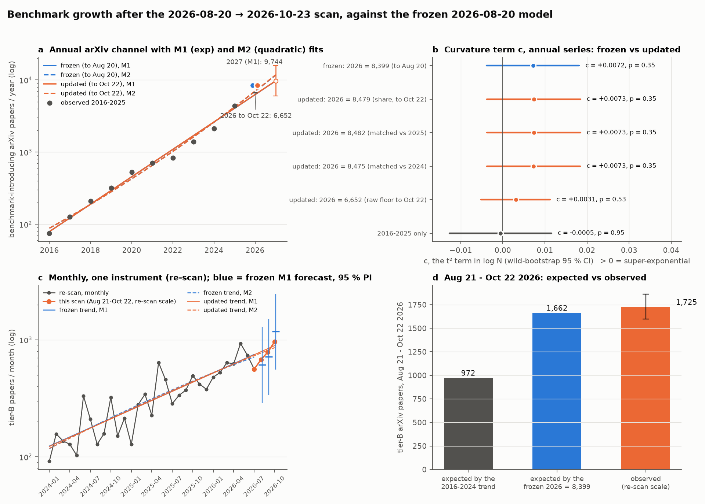
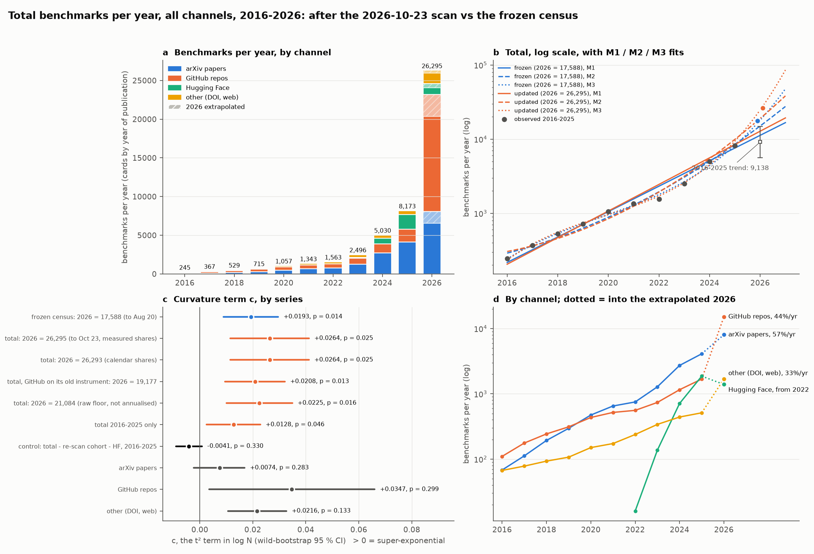

# Growth update after the 2026-10-23 scan

An addendum to the frozen report in `../benchmark_growth/` (cut-off 2026-08-20). The
2026-08-20 → 2026-10-23 scan judged every arXiv paper in the window with the pipeline's gate;
this note feeds that into the frozen report's arXiv channel (§10.2) and re-runs its fits (§11),
side by side with the pre-scan model.

**In one line: the scan landed on the pre-scan model.** The 2026 estimate moves from 8,399 to
8,479 (+1 %), the growth rate from 54.8 % to 54.9 %/yr, and the super-exponential term from
c = +0.0072 to +0.0073, still not significant (p = 0.35). Nothing changes the frozen verdict:
**curvature is not identified**.



## 1. What the scan measured

Same instrument both years: arXiv papers dated **Aug 21 – Oct 22** (Aug 20 is already in the
re-scan, Oct 23 was the scan day), judged *introduces an evaluation resource with a scoring
protocol* (tier B) by gpt-6-luna with the pipeline's paper prompt.

| | Frame | Tier B | Share |
|---|---|---|---|
| 2025 window (calibration scan) | 2,129 | 956 | 44.9 % |
| 2026 window (this scan) | 3,502 | 1,959 | 55.9 % |
| **Year-on-year ratio** | 1.64 | **2.05** [1.90, 2.21] | |

The gate counts more than the re-scan did: its 2025-window count is **113.6 %** of the re-scan's
for the same days. Dividing by that recall puts the 2026 window on the re-scan's scale:
**1,725 [1,597, 1,864]** papers.

**Against the pre-scan models** (fig d): the frozen 2026 = 8,399 implied **1,662** for this window
(the window is 19.8 % of a year, measured on 2024–2025); the 2016–2024 trend implied **972**.
The observation is 3.8 % above the frozen estimate and inside its interval; it is 77 % above the
decade trend.

## 2. 2026, re-annualised

2026 to Oct 22 = 4,927 (re-scan, to Aug 20) + 1,725 = **6,652**, a hard floor. Annualised by the
frozen report's three methods, with 78.5 % of the year's papers now counted (by the re-scan's
measured share; 80.8 % by calendar):

| Method | Frozen (to Aug 20) | **Updated (to Oct 22)** |
|---|---|---|
| ÷ re-scan share of year elapsed | 8,399 | **8,479** |
| matched window × 2025 full year | 8,080 | **8,482** |
| matched window × 2024 full year | 8,204 | **8,475** |

The three methods now agree within 0.1 % (they spanned 4 % before), because two more months of
the year are counted rather than inferred.

## 3. The annual fits — arXiv channel 2016–2026, log space, t centred at 2021

Series: W0 × 1.0923 for 2016–2023, re-scan for 2024–2025, 2026 as above. Wild bootstrap,
Rademacher, B = 20,000, seed 17 — as the frozen `fit_superexp.py`, which this reproduces exactly
on the frozen series.

**M1, exponential: `log N = a + b·t`**

| | Frozen | **Updated** |
|---|---|---|
| a | 6.55826 | 6.55913 |
| b | 0.43712 (se 0.01697) | **0.43755** (se 0.01713) |
| t, p | 25.76, 9.6 × 10⁻¹⁰ | 25.54, 1.0 × 10⁻⁹ |
| b, 95 % CI | [0.3987, 0.4755] | [0.3988, 0.4763] |
| **annual growth** | 54.8 % [49.0, 60.9] | **54.9 % [49.0, 61.0]** |
| HAC (lag 2) CI | [48.5, 61.4] | [48.5, 61.6] |
| doubling time | 19.0 months | 19.0 months |
| R², residual sd | 0.9866, 0.178 | 0.9864, 0.180 |
| DW, ρ₁ | 0.84, +0.53 | 0.84, +0.53 |

**M2, quadratic in the exponent: `+ c·t²`** — super-exponential if c > 0

| | Frozen | **Updated** |
|---|---|---|
| **c** | +0.00716 (se 0.00592) | **+0.00733** (se 0.00597) |
| OLS 95 % CI | [−0.0065, +0.0208] | [−0.0064, +0.0211] |
| **wild-bootstrap 95 % CI** | [−0.0038, +0.0181] | **[−0.0038, +0.0184]** |
| p: OLS / HAC / bootstrap | 0.26 / 0.34 / 0.35 | **0.25 / 0.33 / 0.35** |
| F(1, 8), M1 → M2 | 1.46 | 1.51 |
| implied rate, 2016 → 2026 | 44 % → 66 % | 44 % → 67 % |

**M3, cubic: `+ d·t³`**

| | Frozen | **Updated** |
|---|---|---|
| d | +0.00561 (se 0.00103), p = 0.0010 | +0.00567 (se 0.00103), p = 0.0009 |
| d, 95 % CI | [+0.0032, +0.0081] | [+0.0032, +0.0081] |
| implied rate 2016 / 2020 / 2023 / 2026 | 99 / 40 / 54 / 129 % | 99 / 40 / 54 / 131 % |
| rate minimum | 2020.6 | 2020.6 |

**Model comparison** (ΔAICc, Akaike weight, leave-one-out RMSE in log units)

| | M1 | M2 | M3 |
|---|---|---|---|
| frozen | 7.43, 0.024, 0.202 | 10.82, 0.004, 0.235 | **0, 0.972, 0.109** |
| updated | 7.72, 0.021, 0.205 | 11.06, 0.004, 0.238 | **0, 0.976, 0.109** |

The cubic wins on AICc in both, and its d is significant — exactly as in the frozen §11.3, and
it means the same thing there: with d > 0 the fitted rate is a **U with its floor at 2020**, a
slowdown and a recovery, not a rate rising throughout. The quadratic term — the one that encodes
"accelerating" — is what tests super-exponential growth, and it is not significant.

**Sensitivity** — every way of entering 2026:

| 2026 entered as | Growth (M1) | c | bootstrap CI | p |
|---|---|---|---|---|
| frozen 8,399 | 54.8 % | +0.0072 | [−0.0038, +0.0181] | 0.35 |
| updated 8,479 (share) | 54.9 % | +0.0073 | [−0.0038, +0.0184] | 0.35 |
| updated 8,482 (matched 2025) | 54.9 % | +0.0073 | [−0.0038, +0.0184] | 0.35 |
| updated 8,475 (matched 2024) | 54.9 % | +0.0073 | [−0.0038, +0.0184] | 0.35 |
| raw floor 6,652, not annualised | 53.2 % | +0.0031 | [−0.0051, +0.0112] | 0.53 |
| 2016–2025, no 2026 | 51.8 % | −0.0005 | [−0.0127, +0.0115] | 0.95 |

**Out of sample.** The 2016–2024 fit predicts 2025 = 3,261 [2,280, 4,662] (actual 4,359,
z = +1.92) and 2026 = 4,873 [3,338, 7,115] (updated 8,479, **z = +3.46**; frozen +3.40). 2026
stays outside the decade trend's interval: the last two years are above it, as the frozen
headline says.

**2027, for reference only:** M1 9,744 [6,005, 15,811] (frozen 9,711); M2 11,790
[6,479, 21,456]; M3 21,897 [14,832, 32,326]. The models diverge by a factor of two one year
out — another way of saying the curvature is not pinned down.

## 4. The monthly test, inside one instrument

The re-scan alone, 2024-01 → 2026-10 (the scan's months on the re-scan scale; October scaled
from 22 days), month dummies plus a polynomial trend. One instrument, no splice, no
annualisation.

| | Frozen (to 2026-07, n = 31) | **Updated (to 2026-10, n = 34)** |
|---|---|---|
| growth (M1) | 105.6 %/yr, HAC CI [85.3, 128.2] | **105.6 %/yr, HAC CI [91.1, 121.3]** |
| c | −0.050, HAC CI [−0.247, +0.146], p = 0.60 | **−0.033, HAC CI [−0.137, +0.072], p = 0.52** |
| d | −0.161, HAC p = 0.15 | −0.078, HAC p = 0.33 |
| ΔAICc M1 / M2 / M3 | 0 / 7.39 / 14.70 | **0 / 6.27 / 12.92** |

Inside the re-scan the plain exponential wins clearly and c is slightly *negative*: 2024–2026
grew at a steady ~100 %/yr, not an accelerating one. **The frozen monthly M1, never having
seen them, forecast the three new months well:** Aug 611 [290, 1,290] vs 678 (z = +0.29),
Sep 715 [339, 1,508] vs 786 (z = +0.27), Oct 1,176 [557, 2,481] vs 967 (z = −0.55).

## 5. Verdict

- **The pre-scan model held.** The new window came in at 1,725 against 1,662 expected (+3.8 %);
  2026 moves from 8,399 to 8,479; every coefficient moves in the third decimal.
- **Growth rate: 54.9 %/yr [49.0, 61.0], doubling every 19.0 months** over 2016–2026; ~100 %/yr
  inside the re-scan over 2024–2026.
- **Super-exponential (t²): not supported.** c = +0.0073, bootstrap CI [−0.0038, +0.0184],
  p = 0.35 annually; c = −0.033, p = 0.52 monthly within one instrument.
- **Cubic (t³): significant, but it describes a U-shaped rate** (minimum 2020.6), not
  acceleration. Same as frozen §11.3, and it carries the same caveat: the 2016–2023 years come
  from a different, censored instrument (W0), and the splice sits right where the curve bends.
- The frozen report's limit still applies: the 2024–2026 surge and the 2021–22 flat spot can't
  be separated from the instruments that saw them until another channel is re-enumerated.

## 6. The total, all channels (the census)

Every card counted once, in its year of publication: the frozen report's §7 census, now with
the scan's 10,157 cards. 2016–2025 are unchanged (the scan only added 2026 cards), so the
comparison with the frozen census is direct. Fig: `fig_total_update.png`; numbers:
`results_total.json`; script: `scripts/analyze_total.py`.



**2026 to a full year.** Most cards have a year but no month, so each channel's 2026 count is
divided by the share of a year's output published by that channel's cut-off, measured on the
frozen panel's month-resolvable cards over 2016–2024 (it reproduces the frozen 0.6213 for
Aug 20). arXiv, GitHub and other were scanned to **Oct 23** (share **0.8119**, sd 0.017;
calendar 0.8110); Hugging Face only to **Aug 20** (0.6213), because the pipeline doesn't scan it.

| Channel | 2016 | 2018 | 2020 | 2022 | 2023 | 2024 | 2025 | 2026 observed | of which this scan | **2026 annualised** |
|---|---|---|---|---|---|---|---|---|---|---|
| arXiv papers | 68 | 193 | 473 | 751 | 1,281 | 2,722 | 4,109 | 6,539 | 1,623 | **8,053** |
| GitHub repos | 110 | 243 | 434 | 558 | 738 | 1,156 | 1,686 | 12,312 | 7,313 | **15,164** |
| Hugging Face | 0 | 0 | 0 | 16 | 137 | 711 | 1,866 | 866 | 0 | **1,394** |
| other (DOI, web) | 67 | 93 | 150 | 238 | 340 | 441 | 512 | 1,367 | 1,221 | **1,684** |
| **Total** | 245 | 529 | 1,057 | 1,563 | 2,496 | 5,030 | 8,173 | 21,084 | 10,157 | **26,295** |

The frozen census put 2026 at **17,588**. The new total is **26,295**, 3.2× 2025 — and the
"of which this scan" column says where the jump comes from: GitHub's 2026 jumps 9× over 2025
because the scan harvested repos with no star floor (7,313 of 12,312 in 64 days), and "other"
jumps 3.3× because OpenAlex and Crossref entered for the first time (1,221 of 1,367).

**Fits, 2016–2026, log space, t centred at 2021**

| Series | Growth (M1) [95 % CI] | doubling | R² | **c** [bootstrap 95 % CI] | p (boot) | d, p | best (Akaike weight) |
|---|---|---|---|---|---|---|---|
| frozen census, 2026 = 17,588 | 48.4 % [40.8, 56.4] | 21.1 mo | 0.970 | **+0.0193** [+0.0089, +0.0296] | 0.014 | +0.0050, 0.003 | M3 (0.98) |
| **total, 2026 = 26,295** | **51.1 % [40.7, 62.4]** | 20.1 mo | 0.949 | **+0.0264** [+0.0115, +0.0412] | **0.025** | +0.0074, 0.001 | M3 (1.00) |
| total, calendar shares, 26,293 | 51.1 % [40.7, 62.4] | 20.1 mo | 0.949 | +0.0264 [+0.0115, +0.0412] | 0.025 | +0.0074, 0.001 | M3 |
| total, GitHub on its old instrument, 19,177 | 49.0 % [40.8, 57.6] | 20.9 mo | 0.966 | +0.0208 [+0.0095, +0.0321] | 0.013 | +0.0055, 0.001 | M3 |
| total, raw floor 21,084 | 49.6 % [40.8, 59.0] | 20.6 mo | 0.962 | +0.0225 [+0.0100, +0.0349] | 0.016 | +0.0061, 0.001 | M3 |
| total, 2016–2025 | 44.1 % [37.9, 50.5] | 22.8 mo | 0.979 | +0.0128 [+0.0026, +0.0228] | 0.046 | +0.0057, 0.014 | M3 (0.45) / M1 (0.37) |
| **control: − re-scan cohort − HF, 2016–2025** | 36.9 % [34.0, 39.8] | 26.5 mo | 0.993 | **−0.0041** [−0.0090, +0.0008] | 0.330 | +0.0017, 0.27 | **M1 (0.89)** |
| arXiv papers | 57.0 % [51.3, 62.9] | 18.4 mo | 0.988 | +0.0074 [−0.0023, +0.0169] | 0.283 | +0.0045, 0.018 | **M1 (0.54)** |
| GitHub repos | 44.3 % [27.5, 63.2] | 22.7 mo | 0.834 | +0.0347 [+0.0035, +0.0660] | 0.299 | +0.0149, 0.004 | M3 (0.92) |
| other (DOI, web) | 32.7 % [25.0, 40.8] | 29.4 mo | 0.927 | +0.0216 [+0.0106, +0.0327] | 0.133 | +0.0035, 0.16 | M2 (0.80) |

Total, M1: b = 0.4131 (se 0.0318, p = 3.9 × 10⁻⁷), against the frozen 0.3948 (se 0.0231).
M2: c = +0.02635 (se 0.00766; OLS p = 0.009, HAC p = 0.019, bootstrap p = 0.025). The cubic's
implied rate runs 77 % (2016) → 29 % (2020) → 61 % (2023) → 200 % (2026), minimum at 2019.8 —
the same U as the frozen census (63 → 33 → 56 → 140 %, minimum 2019.7), with a steeper right
arm. The 2016–2025 total trend predicts 2026 = 9,138 [5,650, 14,780]; 26,295 is z = +5.07
(frozen 17,588: z = +3.14). 2027, for reference only: M1 19,334 [7,881, 47,430], M2 38,362,
M3 85,673 — a 4× spread.

(Hugging Face isn't fitted on its own: it exists from 2022. For GitHub the bootstrap CI excludes 0
while the null-bootstrap p is 0.30; with an R² of 0.83 and a 9× instrument jump in its last point,
neither number means much.)

**Reading it.** On the total, c is positive and significant in every variant that includes 2026,
and larger than in the frozen census (+0.026 vs +0.019). That's the answer to "is the total
super-exponential" taken at face value. It shouldn't be taken at face value, for the frozen
report's reason (§11.1), now stronger:

- **The curvature sits exactly where channels switch on.** HF starts in 2022, the arXiv re-scan
  cohort lands only in 2024–2026, and this scan adds GitHub with no star floor and OpenAlex/Crossref
  only in 2026. Each lifts the late years of a pooled series without any channel changing its
  behaviour. Remove the two pre-scan ones and 2016–2025 has **c = −0.0041, p = 0.33**, with plain
  exponential ahead (Akaike weight 0.89) — reproduced exactly here.
- **The one channel observed by a consistent instrument, arXiv, shows no curvature**: c = +0.0074,
  p = 0.28, M1 preferred, growth 57 %/yr — the same answer as the spliced arXiv series in §3
  (c = +0.0073, p = 0.35).
- **Putting GitHub back on its old instrument** (dropping the scan's no-floor repos) only takes the
  total from 26,295 to 19,177 and c from +0.026 to +0.021; what's left is the re-scan, HF and
  OpenAlex/Crossref lift.

So the total grows at about **50 %/yr** (51.1 % [40.7, 62.4] with 2026 annualised), and its
apparent super-exponential term is a property of how the corpus was collected, not of
benchmark output. The total is the right number for "how many benchmarks does the corpus hold
per year"; it is not a time series of the field.

## Caveats specific to this update

- **Judge noise.** The 2026 window was gated twice by the same model — synchronously for the
  dry run, then through the batch API for the production gate. They agree on 94.8 % of the 3,502
  papers; the batch run accepts 2.5 % more (1,959 vs 1,912). With the synchronous verdicts 2026
  annualises to 8,426 instead of 8,479. The 2025 calibration was judged synchronously only.
- **One calibration window.** The recall factor (113.6 %) comes from one 63-day window in 2025
  and is assumed to hold in 2026.
- **Semantic Scholar contributed nothing** (rejected key), and none of this uses the GitHub,
  OpenAlex or Crossref cards: the frozen report's arXiv channel is the only series with one
  instrument across the window that the scan could extend. The GitHub cards from this scan
  were taken with no star floor, so they are not comparable with the corpus's earlier GitHub
  channel.

## Reproducing

```bash
# needs the gitignored run files and the calibration answer cache; writes inputs/
python scripts/export_inputs.py <calibration answers.json>
# runs from inputs/ and ../benchmark_growth/ alone
python scripts/analyze.py       # -> results.json, fig_growth_update.png
python scripts/analyze_total.py --export   # snapshot the corpus -> inputs/total_panel.csv.gz
python scripts/analyze_total.py            # -> results_total.json, fig_total_update.png
```
